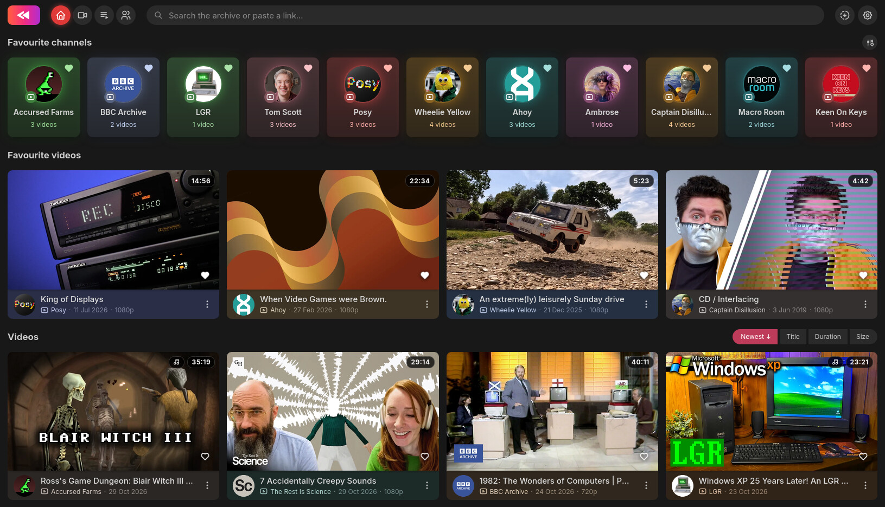

<p align="center">
  
</p>

# Reruns

Reruns is a web-based gallery and player for videos archived with
[yt-dlp](https://github.com/yt-dlp/yt-dlp).

- **Download** - paste URLs to videos, playlists or channels and download videos
  directly into your media library, or search YouTube directly within the app to
  find new content
- **Browse** - view videos, channels and playlists; a customisable home page
  shows your favourites first
- **Watch** - use the integrated video/audio player with immersive mode, player
  effects, subtitles, autoplay, background play and more
- **Subscribe** - automatically fetch new videos from a channel or playlist on a
  customised schedule
- **Ad-free** - use SponsorBlock to automatically skip or fast-forward the
  sponsor messages, previews, intros, etc.

## Screenshots



[View more screenshots](screenshots/README.md), including playback, browsing,
appearance settings and mobile views.

## Installation

The easiest way is to use the supplied docker image. It includes a stripped down
ffmpeg to save space and will fetch the latest yt-dlp every 24 hours.

### Docker

Docker bundles the download tools, including ffmpeg, deno and yt-dlp.

1. Download and customise [compose.yaml](compose.yaml), replacing `/path/to/videos`
   with the folder where you want to store your media. Multiple paths are supported.
2. Pull the latest version and start it:

   ```sh
   docker compose up -d
   ```

3. Setting up the initial admin account requires a setup token printed in the
   startup log:

   ```sh
   docker compose logs reruns
   ```

### Python

You can also start Reruns directly without docker:

```sh
python3 -m venv .venv
source .venv/bin/activate
python -m pip install '.[downloads]'
python -m reruns ~/Videos/ytdlp
```

It requires Python 3.11 or newer.

Replace `~/Videos/ytdlp` with your media folder. For downloads, install ffmpeg
and a yt-dlp-supported JavaScript runtime such as deno separately.

## Setup

1. Open <http://127.0.0.1:8800/>.
2. Paste the one-time setup token from the server console or Docker log and
   create your admin account.
3. Configure the initial library path. Make sure to include it in your compose
   file.
4. Add or change folders later under **Settings > Library folders**. To share
   the library, add users and grant folder access under **Settings > Accounts**.

## No authentication

For Docker Compose, add this under the service's `environment` section:

```sh
RERUNS_NO_AUTH=true
```

Run `docker compose up -d` to recreate the container. If running directly,
specify `--no-auth` on the command line or set `RERUNS_NO_AUTH=true` in the
server environment.

With authentication disabled, account creation is skipped, OIDC configuration
is ignored, and every visitor gets full administrator access. Library paths,
subscriptions, favourites, download profiles, playlist order and shared defaults
are saved on the server. Viewer preferences, such as appearance, playback
settings and resume positions, stay in the browser. Existing accounts and their
personal data are preserved for when authentication is enabled again.

## OIDC

OIDC accounts and regular local accounts are supported side by side and do not
merge.

If you'd prefer to set up your initial admin account as an OIDC user, first
configure your identity provider using the environment variables:

```sh
RERUNS_OIDC_ISSUER=https://identity.example.com
RERUNS_OIDC_CLIENT_ID=reruns
RERUNS_OIDC_CLIENT_SECRET=your-client-secret
RERUNS_PUBLIC_URL=https://reruns.example.com
RERUNS_OIDC_NAME=Pocket ID   # optional: the sign-in button reads "Sign in with Pocket ID"
```

Then configure the name of the group from your OIDC provider that will contain
admin users.
Add your account to that group and log in to complete the admin setup.

```sh
RERUNS_OIDC_ADMIN_GROUP=reruns_admin   # optional: members automatically become admins
```

Normal users will be assigned from this group:

```sh
RERUNS_OIDC_USER_GROUP=reruns_user     # optional: members automatically become normal users
```

Anyone not in either group will require manual admin approval.

## Existing media

Existing media needs matching `.info.json` files from yt-dlp to appear in the
gallery. These files will not be automatically created for existing downloads. If
you prefer to download files directly with yt-dlp, make sure to use the following
command-line parameters:

```sh
yt-dlp --write-info-json --write-thumbnail -o '%(uploader)s/%(title)s.%(ext)s' URL
```

## License

Reruns is licensed under the [MIT License](LICENSE). Bundled third-party
components retain their own licenses.
