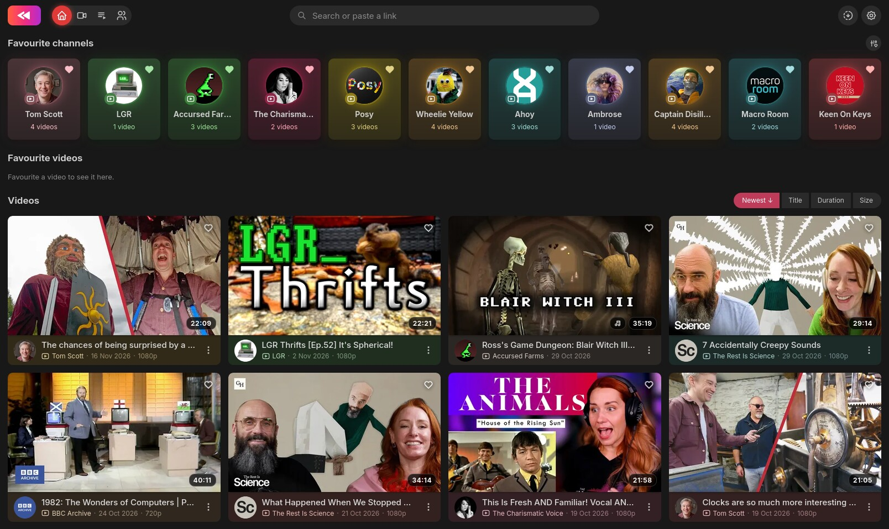
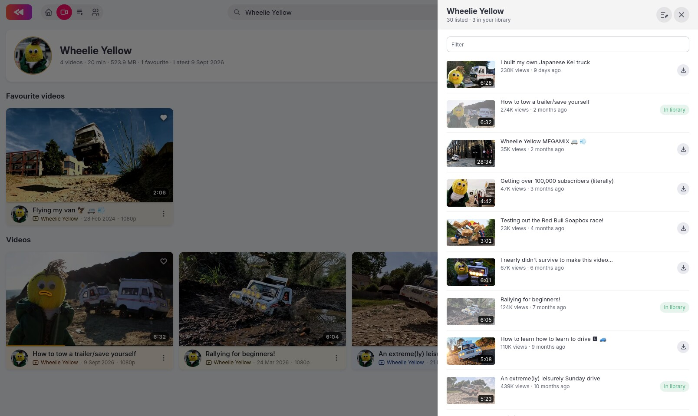
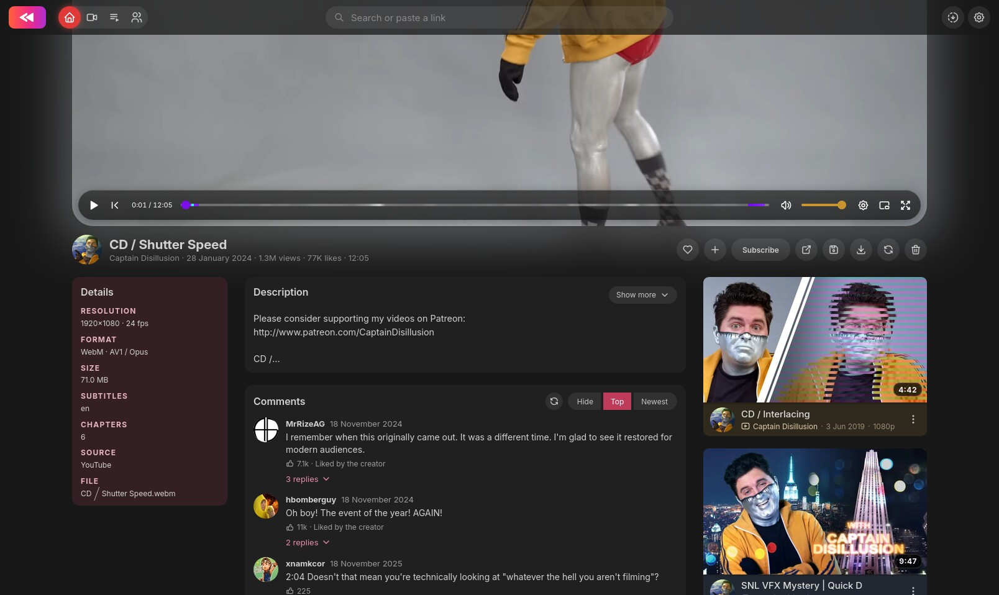
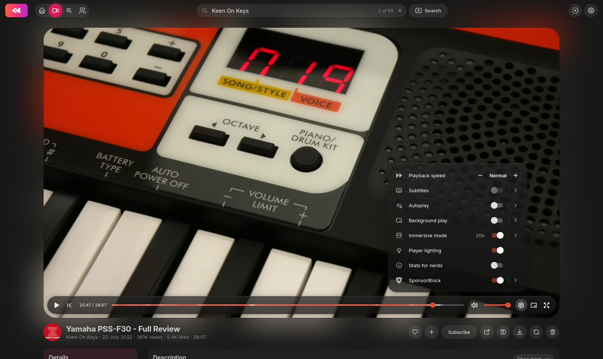
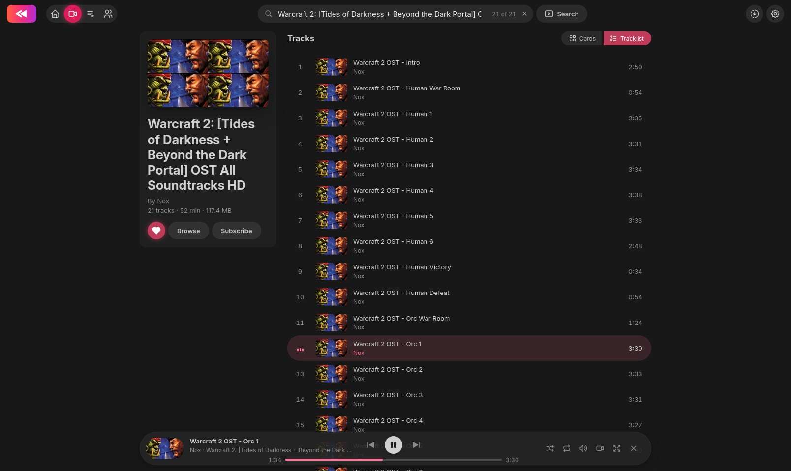
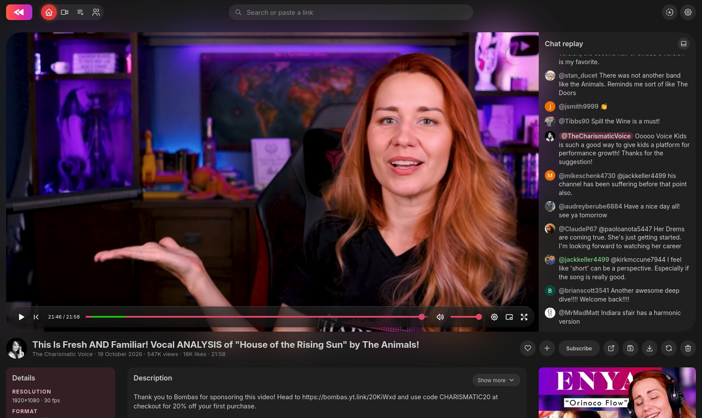
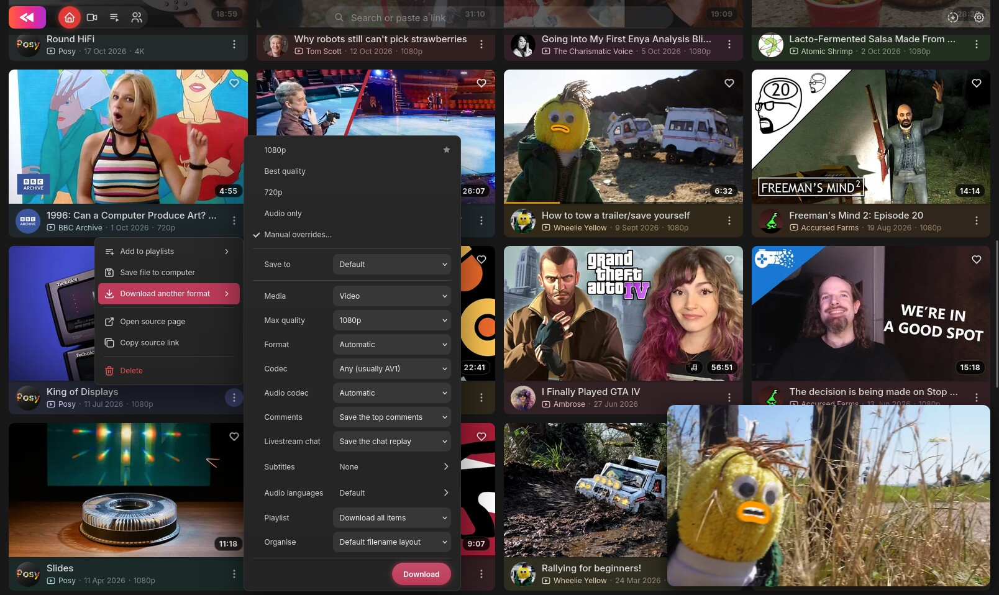
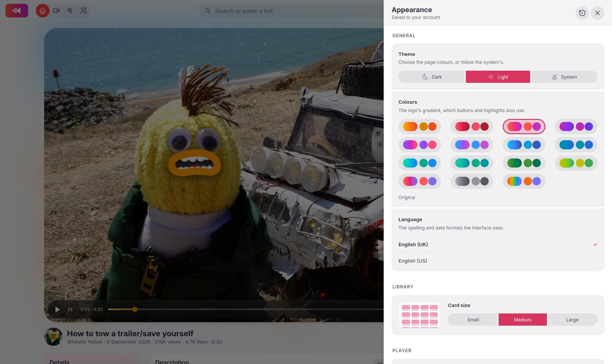
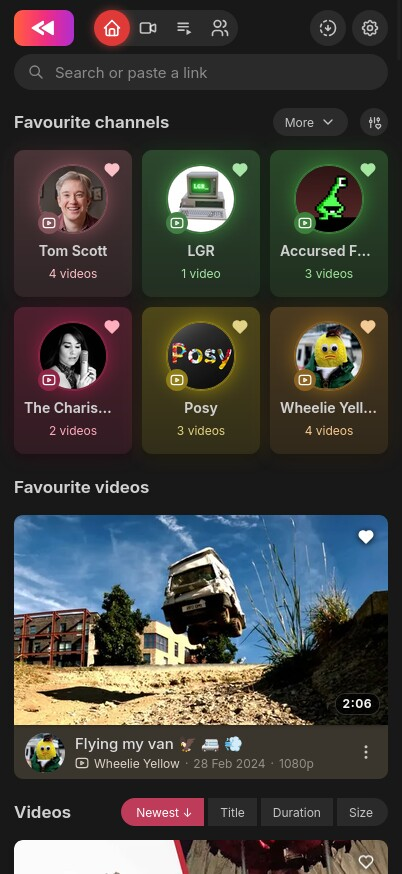
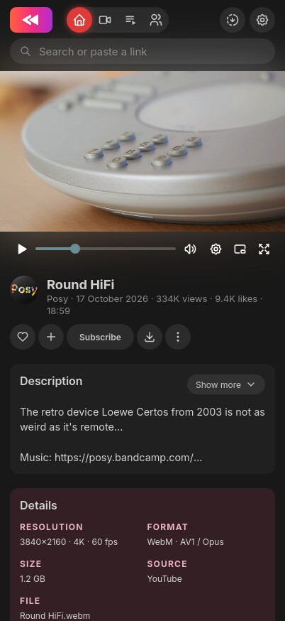

# Screenshots

[Back to the main README](../README.md)

## Desktop

### Home

### Browse

### Watch page

### Player controls

### Audio playlist

### Chat replay

### Download options

### Appearance settings

## Mobile

### Home

### Player

